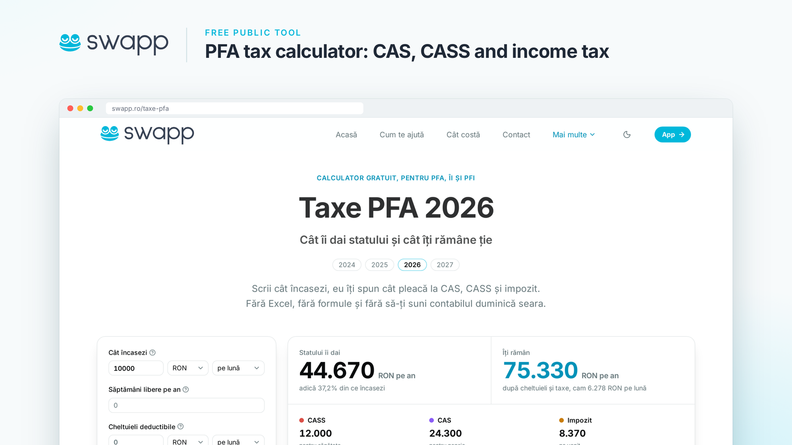

# Taxe PFA s-a mutat pe [swapp.ro/taxe-pfa](https://swapp.ro/taxe-pfa)

Calculatorul de taxe pe care l-am publicat aici în 2023 a crescut și face acum parte din [swapp.ro](https://swapp.ro), pentru PFA, ÎI și PFI.

Scrii cât încasezi, eu îți spun cât pleacă la CAS, CASS și impozit.

**[Calculează-ți taxele pe swapp.ro/taxe-pfa](https://swapp.ro/taxe-pfa)**

---

**English:** this PFA tax calculator now lives at [swapp.ro/taxe-pfa](https://swapp.ro/taxe-pfa), part of [swapp.ro](https://swapp.ro), invoicing and single-entry accounting for Romanian sole traders. [taxepfa.github.io](https://taxepfa.github.io) redirects there. The original Next.js source remains in this repository's history, tagged [`nextjs-calculator`](https://github.com/taxepfa/taxepfa.github.io/tree/nextjs-calculator), under the [MIT License](LICENSE). Thanks to everyone who contributed to it.
